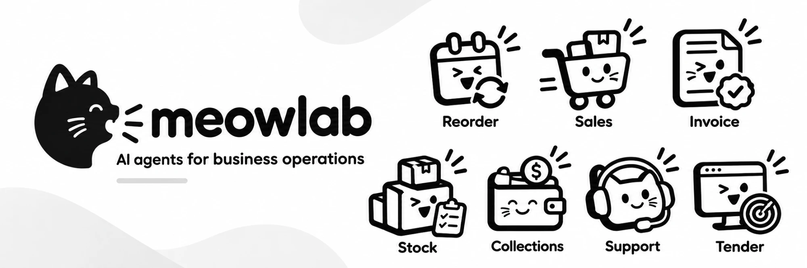
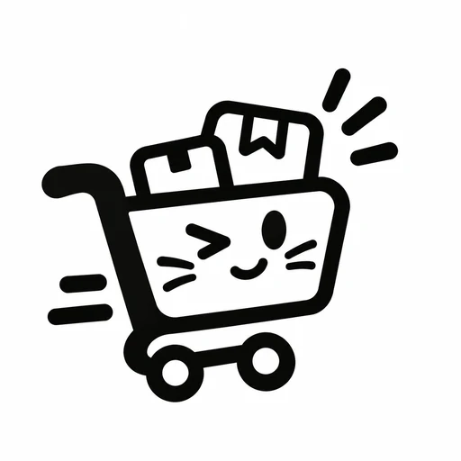
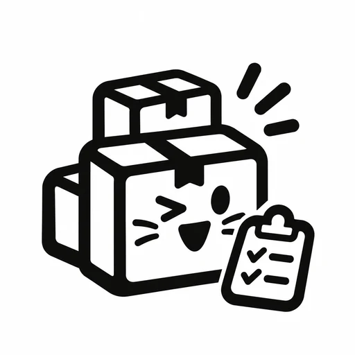
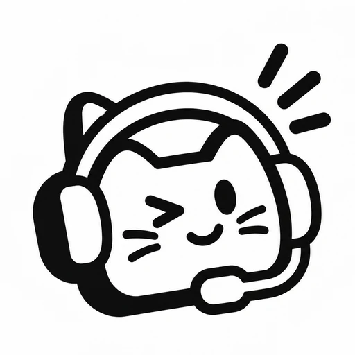
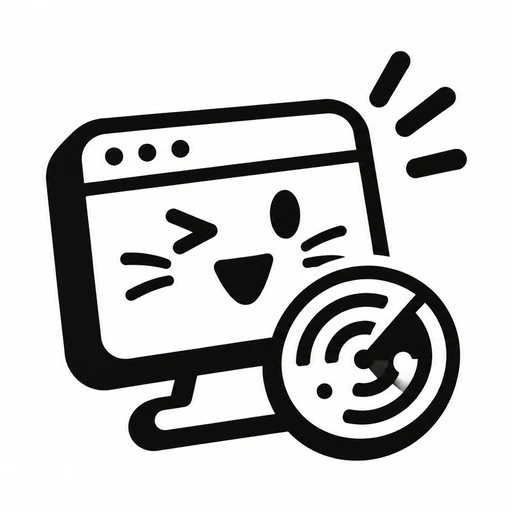

**A team of AI agents for Peruvian small businesses, right inside WhatsApp.**

The business owner writes to them in a single chat, just like messaging someone on her team, 
and the right cat gets the job done. Anything important, she confirms with one tap.

[meowlab.tech](https://meowlab.tech) · [app.meowlab.tech](https://app.meowlab.tech)

---

## Meet the cats

Each cat is an agent with a clear job. They all live in the same WhatsApp chat and hand work off to each other.

| | Cat | What it does for the business |
| :---: | --- | --- |
|  | **Sales Cat** | Records sales, builds PDF quotes, serves customers and flags when they accept an order |
|  | **Invoice Cat** | Issues invoices, receipts, credit notes and shipping guides with SUNAT, Peru's tax authority |
|  | **Stock Cat** | Keeps inventory and warns before anything runs out; stock goes down automatically with every sale |
|  | **Collections Cat** | Tracks what customers owe, sends tactful reminders and validates payments via Yape or Mercado Pago |
|  | **Reorder Cat** | Suggests restocking, compares supplier prices and messages suppliers on the business's behalf |
|  | **Support Cat** | 24/7 after-sales: answers common questions and only escalates what it doesn't know |
|  | **Tender Cat** | Finds public procurement tenders that fit the business and helps prepare the bid |

---

## What we've built

**Since August 26, 2026**

<table>
<tr>
<td align="center"><b>7</b> cats in production</td>
<td align="center"><b>140</b> reviewed and merged changes</td>
<td align="center"><b>1,000+</b> automated tests</td>
<td align="center"><b>20</b> documented architecture decisions</td>
</tr>
</table>

- **One chat for everything.** The owner types, sends a voice note, a photo or a PDF, and the right cat understands it. Bursts of messages are grouped so the cat answers once.
- **Real e-invoicing with SUNAT,** with digital certificates and shipping guides, from the chat or the web portal.
- **Frictionless payments:** subscriptions and one-time payments with Mercado Pago and Yape, plus a payment link for each customer debt.
- **The business, facing its customers:** Sales and Support answer on the company's own WhatsApp, quote from the catalog, and the owner can take over the conversation at any time.
- **Suppliers included:** Reorder requests prices from several suppliers, places the firm order and follows up when they don't reply.
- **One daily summary.** A single evening message covering what happened across all cats, instead of transcripts.
- **Web portal** ([app.meowlab.tech](https://app.meowlab.tech)): companies and team invitations, the cat council with the week's activity, plan and payments, a complaints book as required by Peruvian law, and settings for every cat.
- **Security by design:** every company isolated from the others, signed messages between services, secrets kept out of the code, and everything deployed comes from a reviewed commit.

### How it's built

| Layer | Technology |
| --- | --- |
| WhatsApp entry point | Meta Cloud API and Kapso, behind a single signed webhook |
| Conversations | Cloudflare Workers, D1, Durable Objects, R2 and Browser Run (PDF) |
| Each company's business data | Node service on a VPS with PostgreSQL, one schema per cat |
| Portal | Hono + React, secure sessions, Android app on the way |
| Intelligence | Language models for text, audio, images and documents, always with structured outputs |

---

## Where we're heading

**1. Reusable cats, built from one mold.** Each cat becomes a spec sheet (the topics it owns, who it talks to, its tools, its tasks and its personality) on top of a shared runtime. The core is already built; Sales moves first and the rest follow.

**2. Talk to them without commands.** "How many new customers did I get today?" goes to Sales; "How much does Juan owe me?" goes to Collections. If there are two Juans, the cat asks which one you mean.

**3. Cats that work on their own.** Every cat keeps a task list, visible in the portal, and gets it done on time: following up on quotes, reminding customers about promotions, and messaging at a reasonable hour without losing WhatsApp's conversation window.

**4. Cats that know your business.** Company story, team and current promotions, loaded once in the portal, so every cat answers with that context.

**5. Personality of your choice.** A friendly, a concise or a negotiating Sales Cat in one click, or tuned to fit each business.

**6. MeowLab in your pocket.** The Android app, once the portal has everything the owner needs.

---

Made in Peru, for the people who keep their businesses going every day.

