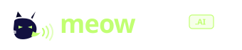
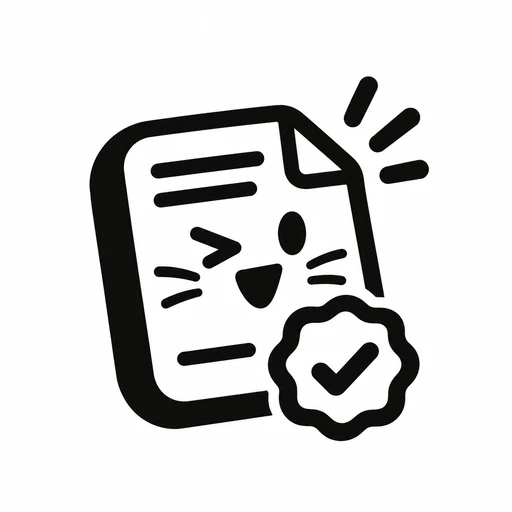

# MeowLab

**Un equipo de agentes de IA para las mypes peruanas, dentro de WhatsApp.**

La dueña del negocio les escribe en un solo chat, como a alguien de su equipo, 
y el gato que corresponde hace el trabajo. Lo importante lo confirma ella con un botón.

[meowlab.tech](https://meowlab.tech) · [app.meowlab.tech](https://app.meowlab.tech)

---

## Los gatos

Cada gato es un agente con un trabajo concreto. Viven en el mismo chat de WhatsApp y se pasan la posta entre ellos.

| | Gato | Qué hace por el negocio |
| :---: | --- | --- |
|  | **Sales Cat** | Registra ventas, arma cotizaciones en PDF, atiende a los clientes y avisa cuando aceptan un pedido |
|  | **Invoice Cat** | Emite facturas, boletas, notas de crédito y guías de remisión ante SUNAT |
|  | **Stock Cat** | Lleva el inventario y avisa antes de que algo se acabe; el stock baja solo con cada venta |
|  | **Collections Cat** | Lleva lo que le deben al negocio, recuerda con tacto y valida pagos por Yape o Mercado Pago |
|  | **Reorder Cat** | Propone reponer, compara precios entre proveedores y les escribe a nombre del negocio |
|  | **Support Cat** | Postventa 24/7: responde preguntas frecuentes y pasa a la dueña solo lo que no sabe |
|  | **Tender Cat** | Encuentra licitaciones del Estado que encajan con el negocio y ayuda con el expediente |

---

## Lo que ya construimos

**Desde el 26 de agosto de 2026**

<table>
<tr>
<td align="center"><b>7</b> gatos en producción</td>
<td align="center"><b>140</b> cambios revisados y fusionados</td>
<td align="center"><b>+1 000</b> pruebas automáticas</td>
<td align="center"><b>20</b> decisiones de arquitectura documentadas</td>
</tr>
</table>

- **Un solo chat para todo.** La dueña escribe o manda un audio, una foto o un PDF, y el gato correcto lo entiende. Las ráfagas de mensajes se agrupan para responder una sola vez.
- **Facturación electrónica real ante SUNAT,** con certificado digital y guías de remisión, desde el chat o desde el portal.
- **Cobros sin fricción:** suscripciones y pagos únicos con Mercado Pago y Yape, y links de pago por cada deuda de un cliente.
- **El negocio frente a sus clientes:** Sales y Support atienden en el WhatsApp de la empresa, cotizan con el catálogo y la dueña puede tomar la conversación cuando quiera.
- **Proveedores incluidos:** Reorder pide precios a varios proveedores, hace el pedido en firme y les insiste si no responden.
- **Un resumen al día.** Un solo mensaje por la noche con lo que pasó en todos los gatos, en vez de transcripciones.
- **Portal web** ([app.meowlab.tech](https://app.meowlab.tech)): empresas e invitaciones al equipo, el consejo de gatos con su actividad de la semana, plan y pagos, Libro de Reclamaciones y la configuración de cada gato.
- **Seguridad desde el diseño:** cada empresa aislada de las demás, mensajes firmados entre servicios, secretos fuera del código y todo lo desplegado sale de un commit revisado.

### Cómo está hecho

| Capa | Tecnología |
| --- | --- |
| Entrada de WhatsApp | Meta Cloud API y Kapso, con un único webhook firmado |
| Conversación | Cloudflare Workers, D1, Durable Objects, R2 y Browser Run (PDF) |
| Negocio de cada empresa | Servicio Node en un VPS con PostgreSQL, un esquema por gato |
| Portal | Hono + React, sesión segura y app Android en camino |
| Inteligencia | Modelos de lenguaje para texto, audio, imágenes y documentos, siempre con respuestas estructuradas |

---

## Hacia dónde vamos

**1. Gatos replicables, con un mismo molde.** Cada gato pasa a ser una ficha (de qué temas es dueño, con quién habla, sus herramientas, sus tareas y su personalidad) sobre un ciclo común. El núcleo ya está construido; Sales es el primero en mudarse y le siguen los demás.

**2. Hablarle sin comandos.** «¿Cuántos clientes nuevos tengo hoy?» llega a Sales; «¿cuánto me debe Juan?» llega a Collections. Si hay dos Juan, el gato pregunta a cuál te refieres.

**3. Gatos que trabajan solos.** Cada gato lleva su lista de tareas, visible en el portal, y las cumple a tiempo: hace seguimiento a cotizaciones, recuerda promociones y escribe en un horario razonable, sin perder la ventana de conversación de WhatsApp.

**4. Que conozcan tu negocio.** Historia, equipo y promociones vigentes cargadas una vez en el portal, para que todos los gatos respondan con ese contexto.

**5. Personalidad a elección.** Un Sales amable, uno conciso o uno negociador, con un clic, o ajustado a la medida de cada negocio.

**6. MeowLab en el bolsillo.** La app Android, cuando el portal tenga todo lo que la dueña necesita.

---

Hecho en Perú, para quienes sacan adelante su negocio todos los días.

